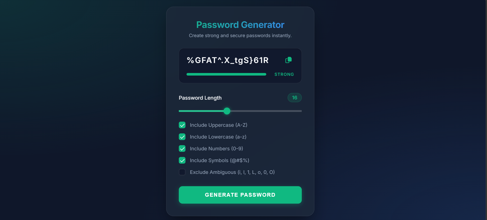

# Password Generator

A responsive and customizable **Password Generator Web App** built using HTML, CSS, and vanilla JavaScript. The application allows users to generate passwords based on their preferred length and character types.

## Live Demo

[View Password Generator](https://jyotilohiya.github.io/password-generator/)

## Screenshot



## Features

* Generate random passwords
* Customize password length
* Include uppercase letters
* Include lowercase letters
* Include numbers
* Include special characters
* Copy generated password to clipboard
* Password strength indicator
* Input validation and error handling
* Responsive design for desktop, tablet, and mobile devices
* Fast client-side password generation

## Technologies Used

* **HTML5** – Structure and semantic markup
* **CSS3** – Styling, responsive design, and UI
* **JavaScript** – Password generation, validation, strength analysis, and clipboard functionality

## Project Structure

```text
password-generator/
│
├── index.html
├── style.css
├── script.js
├── screenshot.png
└── README.md
```

## How It Works

1. Select the desired password length.
2. Choose the character types you want to include.
3. Click **Generate Password**.
4. The application creates a random password based on your selections.
5. Use the **Copy** button to copy the password to your clipboard.
6. The strength indicator provides a basic estimate of password strength.

## Run Locally

Clone the repository:

```bash
git clone https://github.com/jyotilohiya/password-generator.git
```

Open the project folder:

```bash
cd password-generator
```

Then open `index.html` using a browser or run it with a local development server such as Live Server.

## Deployment

The application is deployed using **GitHub Pages**.

**Live Demo:**
https://jyotilohiya.github.io/password-generator/

## Future Improvements

* Add password history with optional local storage
* Add customizable character sets
* Add an option to exclude similar characters
* Improve password strength analysis
* Add dark/light theme support

## Author

**Jyoti Lohiya**
